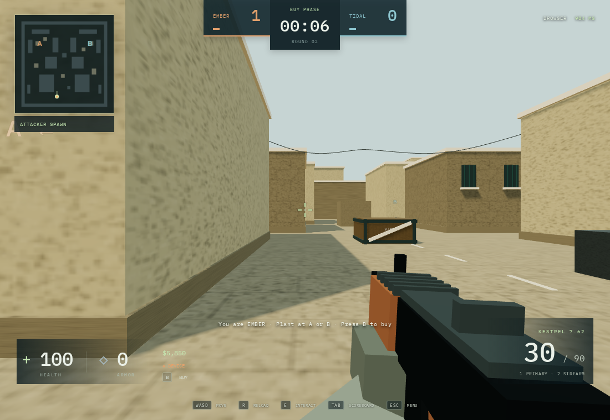

# cs1.618

An original, playable tactical multiplayer FPS inspired by the round-based defusal play of Counter-Strike 1.4/1.5, built on **Verdant Engine** and modeled with the **Prism** toolchain. The repository is `uor-cs1.618`; the game is **cs1.618**.

Two teams, five players per team, two objective sites, one original map: **Meridian**, a coastal relay station. Ember plants the device; Tidal defends or defuses. First to eight rounds wins. All geometry, weapon models, textures, UI and synthesized audio are original.



## Play locally

Node.js 22.12+ (Node 24 recommended):

```sh
npm ci
npm run dev
```

Open **http://localhost:3000**. Choose **Practice with bots** for browser-local play, or **Join multiplayer** for the included WebSocket server. To play together, open the same server and enter the same room code. Empty online slots can be filled with bots; a joining human replaces a bot.

The shipped Wasm binaries are committed. Rust and the Prism SDK are needed only to regenerate them, not to play or host.

## What you can play

- Authoritative 60 Hz server, 20 Hz snapshots, client movement prediction and reconciliation, remote interpolation, isolated named rooms and up to ten players.
- Freeze/buy, live, planted, round-end and match-end phases. Equipment and money persist for survivors; eliminations reset equipment. Win, loss, kill and plant rewards.
- P9 pistol, Kestrel assault rifle, Sentinel assault rifle, Vector SMG and scoped Longbow rifle. Recoil, movement spread, headshots, finite magazines, timed reloads, armor and defusal kits.
- Hold-to-plant and hold-to-defuse, interrupted by movement or releasing E. Dropped-device pickup, elimination/timeout/detonation victory conditions, spectator mode and scoreboard.
- Browser-local 5v5 practice in a worker; online bot fill. Static hosting can run practice without a server.
- Verdant Core's BVH, ray/AABB intersection, vector mathematics and occluded binaural audio execute in the same custom Wasm bridge on client and server.

This is a playable first release, not a feature-complete recreation of Counter-Strike. It has one map and the weapons above; grenades, hostages, ranked matchmaking, accounts, voice chat, lag-compensated rewind and production anti-cheat are not implemented. It uses WebGL2 for presentation, as Verdant Resonance does; it does not claim WebGPU rendering or formal verification of the entire game.

## Controls

| Input | Action |
| --- | --- |
| WASD | Move |
| Mouse / left click | Look / fire |
| Right mouse | Aim; magnified scope with Longbow |
| Space | Jump; cycle living teammates while spectating |
| Shift | Walk quietly |
| Ctrl or C | Crouch |
| R | Reload |
| 1 / 2 | Primary / sidearm |
| B | Buy menu near spawn during the buy window |
| Hold E | Plant at a site / defuse nearby; stand still |
| Tab | Scoreboard |
| Escape | Pause menu, sensitivity, volume, leave |
| Left / right arrow | Alternative horizontal look |

Desktop keyboard and mouse are required for gameplay. Escape releases pointer lock. Online time continues while menus are open.

## Host multiplayer

```sh
npm ci
npm run build
PORT=3000 npm start
```

One Node process serves `dist/` and upgrades `/socket` to WebSocket. `GET /health` provides a health check. `GET /api/rooms` lists room occupancy. `HOST` defaults to `0.0.0.0`; `PORT` defaults to `3000`. Optionally restrict browser origins with comma-separated `ALLOWED_ORIGINS`.

For the public internet, put the server behind a TLS proxy with WebSocket support. An HTTPS client needs a `wss://` server. A Dockerfile and Compose configuration are included; see [deployment instructions](docs/DEPLOYMENT.md).

GitHub Pages hosts the static client and practice mode. It cannot run the persistent multiplayer server. In **Connection settings**, enter the separately hosted server URL, for example `wss://your-game-server.example/socket`. You can share a link with `?room=YOURROOM&server=wss%3A%2F%2Fyour-game-server.example%2Fsocket`.

## Build and verify

```sh
npm test                  # simulation, real Wasm, real WebSocket integration
npm run build             # type check + static client production build
npm run test:browser       # real Chromium clients, input, purchases, combat, practice
npm run verify            # tests, client build, artifact/source integrity
npm run engine:build      # Rust tests + Verdant Wasm bridge (Rust + wasm32 target)
npm run prism:generate    # prism-devrel builder from the checked-in round prompt
npm run prism:verify      # locked SDK check/build/verify (Docker)
npm run package           # source/server + static-client archives
```

For browser tests, install Chromium once with `npx playwright install chromium`. Source regeneration uses sibling upstream checkouts under `../upstream`, pinned in [model/upstream-lock.json](model/upstream-lock.json), or `UPSTREAM_DIR`.

[Verification evidence](docs/VERIFICATION.md) distinguishes checked behavior, imported engine code, formal model evidence and open claims. [Prism architecture](docs/PRISM.md) explains exactly how each of the six requested repositories is used. UORust's [frontier](prism/rust-projection/frontier.toml) remains explicit: it is not a claim that the Rust integration has been fully lifted into Lean.

## Layout

| Directory | Responsibility |
| --- | --- |
| `crates/cs-verdant` | Safe game ABI over the pinned Verdant Core engine |
| `public/wasm` | Shipped game and Prism kernel artifacts |
| `shared` | Map, movement, protocol, economy data and round-kernel bridge |
| `server` | Authoritative match simulation, bot navigation, HTTP/WebSocket host |
| `src` | WebGL presentation, input, UI, Web Audio and local practice worker |
| `model` | Requirements, round decision prompt, upstream pins and artifact digests |
| `prism/app` | LexLean model generated by Prism-DevRel |
| `prism/rust-projection` | UORust's source-derived architecture/security/quality projection |
| `tests`, `scripts` | Regression, network, browser and reproducibility checks |

MIT for original game code. See [THIRD_PARTY_NOTICES.md](THIRD_PARTY_NOTICES.md) for dependencies. This is an independent project, not affiliated with Valve or Counter-Strike.
