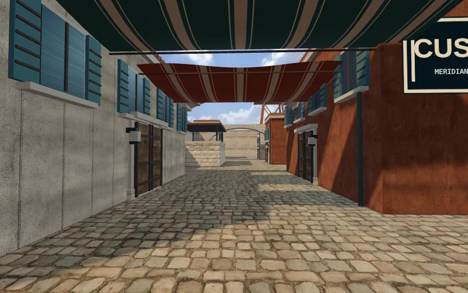
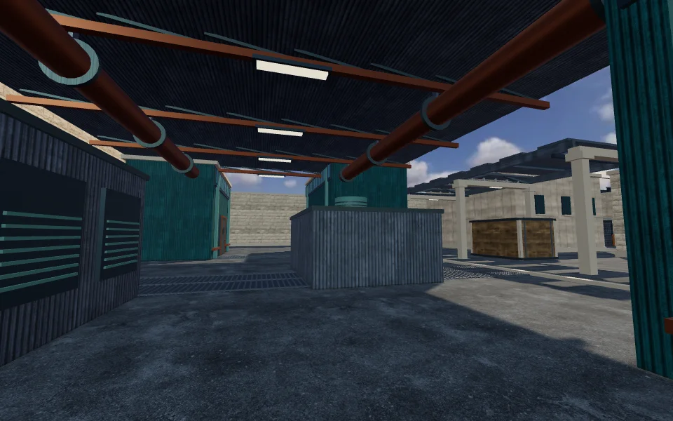

# Meridian field update

## Delivery plan

1. Compare the posed weapon, center of the display and the host's game ray. Verify the correction across screen shapes, loadouts, recoil and scope transitions.
2. Build two new exterior districts with connected entrances, different landmarks and matching Verdant collision. Update the map, radar, navigation and bot assignments together. Run seeded matches to examine movement, first encounters and objective play.
3. Extend the two-slot armory with distinct original equipment. Apply weapon-specific game damage, hit zones, distance and armor in the host simulation. Verify purchases, reloads, costs and elimination credit.
4. Improve surface detail, impact marks, remote motion and sound. Check player perspective and audibility in rendered matches and keep bounded resource use.
5. Save career eliminations and deaths under the player's Prism identity. Exercise storage, replay, account changes, separate practice statistics and portable backups.
6. Run the existing model, artifact, browser multiplayer and deployment gates. Verify the official Pages build, play a round on the published origin, and record the visual and simulation results.

The design draws on Valve's use of environmental sound and distinct footstep surfaces to communicate what happened around a player. The arena, geometry, audio and equipment in cs1.618 are original. [Counter-Strike 2](https://www.counter-strike.net/cs2) · [Valve's footstep update](https://blog.counter-strike.net/2015/11/13087/)

## The expanded arena

Meridian grew from 54 × 54 to 90 × 54 game units. The additional space is playable. Customs Arcade and Pump Hall join West Walk, Mid Court and East Arcade through side entrances and cross streets. Verdant collision, bot navigation, minimap markings and footstep surfaces follow the same layout. The final navigation check reached all 788 cells from spawn and compared 1,950 routes, including the original 480.

| Customs Arcade | Pump Hall |
| --- | --- |
|  |  |

[Customs Square](evidence/field-update/square.webp) · [Inside Pump Hall](evidence/field-update/pump.webp) · [Mid Court](evidence/field-update/mid.webp)

## What the bots did

The headless replay runs the actual ten-player match, collision guest, round guest, economy and damage rules. Three deterministic starting offsets each play three full rounds. Teammate proximity is measured during live play every half second. A visible-contact sample requires the bot to be tracking an opponent.

| Nine-round observation | Earlier game | Field update |
| --- | ---: | ---: |
| Live bot samples with a teammate within 1.8 units | 71.2% | 12.5% |
| Tracking samples where the bot was moving | 17.0% | 71.8% |
| Zones from which bots fired their first shot | 5 | 9 |
| Rounds with a plant | 5 | 8 |

Seven defuses completed in the field-update replay. That outcome describes this seed set. The comparison includes the map and equipment changes. Reproduce the final figures with `npx tsx scripts/bot-round-review.ts`. [Earlier replay](evidence/meridian-quarter/bots-before.json) · [Final replay](evidence/meridian-quarter/bots-after.json)

## Sights, equipment and sound

The first-person model converges toward the center ray at the scene depth. The sight and tracer use the same camera projection as the rendered target. The ray's center follows the game's recoil pattern, and each weapon retains its own dispersion. Sixteen Chromium checks cover all eight weapons in landscape and portrait. [Sight comparison data](evidence/field-update/weapon-aim.json) · [Breaker's sight picture](evidence/field-update/breaker-sights.webp)

Rivet is a second sidearm option, Tern is a semi-automatic carbine, and Breaker uses one shell for six virtual pellets. The armory lists base game damage, magazine capacity, slot and price. Armor, distance and the hit region determine health loss on the host. The map's sunlight and sky illuminate the equipped model. The operators have woven fabric, coated gear and reflective visors. The movement renderer smooths remote player updates between host snapshots.

The audio mixer has eight distinct weapon reports, different steps on asphalt, stone, metal and wood, nearby reflections, and separate equipment and armor feedback. The 15-second stereo sample comes from the actual mixer. [Listen](https://r4-laboratories.github.io/uor-cs1.618/media/meridian-audio.mp3) · [Audio sequence](evidence/field-update/audio.md) · [Operator materials](evidence/field-update/operators.webp)

## Career and multiplayer

Open the Prism identity page and choose a career profile. Multiplayer and practice have separate totals. The browser records host-confirmed counts, including when a match scoreboard resets. A signed backup can be merged on another device linked to the same identity. The identity service supplies signing and linking. Long-term recovery after clearing site data requires both the score backup and access to that identity. [Career profile](https://r4-laboratories.github.io/uor-cs1.618/identity.html#career) · [Storage and transfer](HOLOGRAM.md#private-career-record)

The new map and inventory use multiplayer protocol v3. Reload the game on each device and create a fresh room for this build. In solo practice, use **Choose practice equipment** before deployment to shop while the clock is stopped. Opening the Escape menu pauses solo practice.
